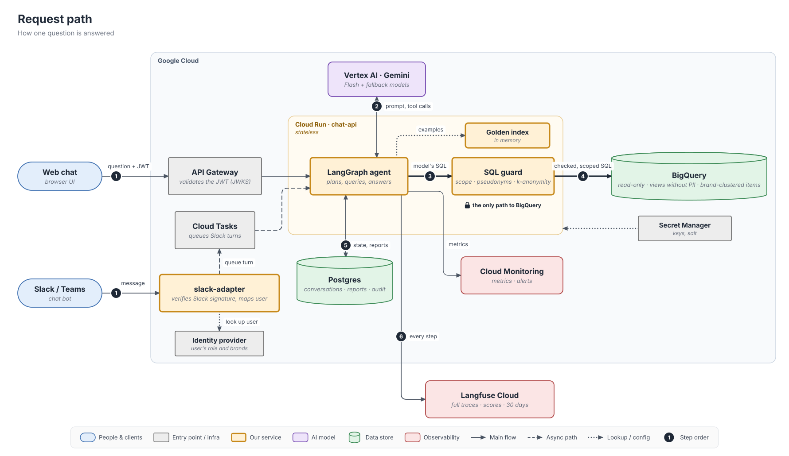
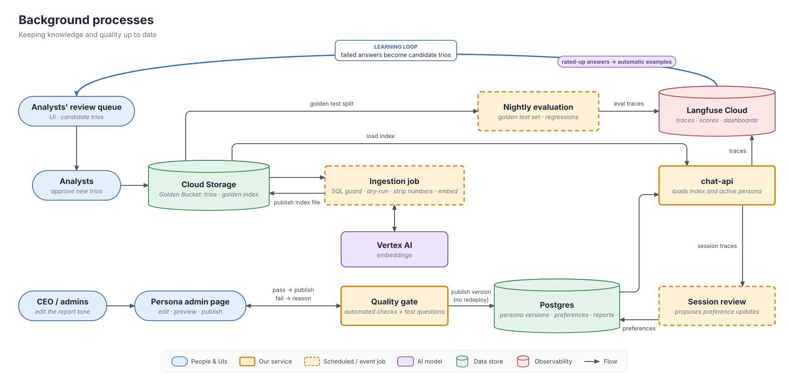
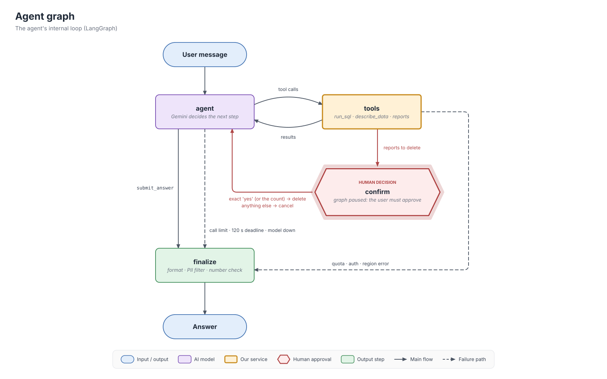

# Retail Analyst Agent — High-Level Design

A chat agent that lets non-technical retail executives analyse sales, customers and products in
BigQuery (`thelook_ecommerce`), discuss the results and get reports with action items.
This document is the production design; the [prototype](../README.md) implements a subset of it
(safety and PII, confirmed deletions, resilience, observability) with the same architecture.

**Contents**

1. [Summary](#1-summary)
2. [Architecture](#2-architecture)
3. [Technology choices](#3-technology-choices)
4. [Data flow](#4-data-flow)
5. [Requirements](#5-requirements)
6. [Error handling and fallbacks](#6-error-handling-and-fallbacks)
7. [Extensibility](#7-extensibility)
8. [Production operations](#8-production-operations)
9. [Setup and example run](#9-setup-and-example-run)
10. [Limitations and next steps](#10-limitations-and-next-steps)

---

## 1. Summary

**One analyst agent, every guarantee in code.** A single Gemini model plans the analysis, writes
SQL, reads the results and writes the answer, in a loop of tool calls (ReAct) inside a small
LangGraph graph. It is never trusted with anything that must not go wrong. The principle used
throughout is **"the model proposes, the code guarantees"**:

| Must never happen                   | Enforced by code, not by the prompt                                                                 |
| ----------------------------------- | --------------------------------------------------------------------------------------------------- |
| A user sees another brand's data    | Every query is parsed and rewritten so each table contains only the user's brands                   |
| PII appears in an answer            | No PII columns are queryable; customer ids are pseudonyms; groups below 5 customers are suppressed |
| The database is changed             | Read-only credentials; only a single `SELECT` over allowed tables passes the SQL guard              |
| Reports are deleted without consent | Deletion pauses the graph; only the user's exact confirmation of the previewed list deletes         |
| Costs explode                       | Dry-run cost check, a byte cap per query, a limit of model calls per question                       |
| A failure is invisible              | Every step of every answer is traced with a trace id                                                |

The model is free where freedom helps: choosing what to query, exploring hypotheses for "why"
questions, and writing the narrative. It answers through a structured `submit_answer` tool that
separates **facts** (each citing the query that produced it) from **hypotheses**,
**recommendations** and **assumptions**.

**Where each requirement is answered**

| # | Requirement | Section | In the prototype |
|---|---|---|---|
| 1 | Hybrid intelligence (Golden Bucket) | 5.1 | sample of 10 trios, BM25 retrieval |
| 2 | Safety and PII | 5.2 | yes |
| 3 | Destructive operations | 4.2, 5.3 | yes |
| 4 | Continuous improvement | 5.4 | design only |
| 5 | Resilience | 6 | yes (`--simulate` to watch it) |
| 6 | Quality assurance | 5.6 | automated tests; evaluation designed |
| 7 | Observability | 5.7 | yes (JSONL, `/trace`, optional Langfuse Cloud) |
| 8 | Persona management | 5.8 | design only |

---

## 2. Architecture

### 2.1 Production architecture

The system has two parts: the **request path** that answers a question in seconds, and
**background processes** that keep the knowledge, the persona and the quality checks up to date.

1. The web client sends the message with the user's JWT; the user's role and brands come from
   its claims, never from the conversation. Slack goes through a small adapter that verifies
   Slack's signature and looks the user up in the identity provider.
2. The agent (`chat-api` on Cloud Run) calls Gemini on Vertex AI with the prompt and the tools.
3. Every SQL statement the model writes goes to the SQL guard.
4. Only the checked and rewritten statement reaches BigQuery, under a read-only service account.
5. Conversation state, saved reports, the audit log, preferences and persona versions are in
   Postgres, so any instance can continue any conversation, including one paused for a deletion
   confirmation.
6. Every step is traced to Langfuse Cloud.

**Background processes.** Analysts approve new Question → SQL → Report trios; an ingestion job
validates each one with the same SQL guard the agent uses and publishes a new Golden Bucket
index. The CEO's tone edits pass an automated quality gate and become a new persona version
without a redeploy. A nightly evaluation runs the test set, and low-rated answers from the traces
become candidate trios, which closes the learning loop.

**Where data lives.**

| Data | Store |
|---|---|
| Transactions | BigQuery, read-only, through views without PII columns |
| Conversations, reports, audit log, preferences, persona versions | Cloud SQL Postgres |
| Golden Bucket trios and index | Cloud Storage (index loaded into memory) |
| Glossary, schema descriptions, dialect rules | Git (config files) |
| Traces and ratings | Langfuse Cloud (PII-redacted, 30 days) |
| Metrics and alerts | Cloud Monitoring |

### 2.2 The agent graph

- **agent** calls the model with the system prompt (rules, the schema of the user's scoped
  tables, metric glossary, dialect rules, the user's scope, up to two Golden Bucket examples) and
  a trimmed history. The model must call a tool; the final answer is the `submit_answer` tool.
  A ceiling of model calls and time per question ends a runaway turn with an honest partial
  answer.
- **tools** executes tool calls through a registry. `delete_reports` only finds the reports and
  records them as pending; it has no side effects.
- **confirm** pauses the graph with LangGraph's `interrupt`. Code, not the model, checks the
  user's reply against the required confirmation.
- **finalize** formats the answer, applies a PII regex, and checks that the numbers in the facts
  appear in the cited query results.

### 2.3 Production and prototype

| Component | Production | Prototype |
|---|---|---|
| Interface | Web chat, Slack adapter over one `chat-api` | CLI (`analyst --user …`) |
| Identity | JWT, brands from claims | `--user` + `config/users.yaml` |
| Graph, tools, SQL guard, confirmation | same | same |
| PII | guard **and** BigQuery views without PII | guard |
| State | Postgres | in-memory conversations, SQLite reports |
| Models | Gemini Flash on Vertex AI, fallback chain | Flash-Lite on AI Studio, 2 fallbacks |
| Golden Bucket | BM25 + embeddings, ingestion pipeline | 10 trios, BM25 |
| Answer quality | numbers rendered by code, critic for reports | non-blocking number check |
| Tracing | Langfuse Cloud, Cloud Monitoring | JSONL + `/trace`, Langfuse if keys are set |

The prototype has the full set of code-level safety controls. What it reduces is quality
tooling that needs a paid model budget and an evaluation set.

---

## 3. Technology choices

| Area | Choice | Main alternative | Why this one |
|---|---|---|---|
| Cloud | **Google Cloud** | AWS (client's preference) | the data (BigQuery) and the model (Gemini) are already there: no cross-cloud calls on every question, one identity system |
| Compute | **Cloud Run** | Vertex AI Agent Engine | full control over our flow (confirmation pause, Slack async turns, streaming); stateless, scales to load |
| Model | **Gemini Flash** | Gemini Pro | latency and cost on every question; the guarantees are in code, not in model strength |
| Agent framework | **LangGraph** | Google ADK | confirmation as a graph node with `interrupt`, a Postgres checkpointer for a stateless service, full control of the loop |
| SQL safety | **sqlglot AST** (parse, check, rewrite) | regex; read-only role only | regex is bypassed by comments and aliases; a read-only role does not stop other brands or PII |
| State | **Postgres** | Firestore | maintained LangGraph checkpointer; reports, audit and preferences are relational |
| Tracing | **Langfuse Cloud** | Cloud Trace / Logging | LLM-aware views (prompts, tool calls, tokens, sessions, scores) with nothing to operate; the client allows it |

**Why GCP when the client prefers AWS.** The client accepts GCP with a justification. A question
makes several model calls and queries; from AWS each would cross clouds. The design uses only
portable building blocks (containers, Postgres, a queue, object storage), so it maps to AWS
one-to-one (App Runner or ECS, RDS, SQS, S3) if the data or the model moves there.

**Models.** Production: `gemini-3.8-flash` on Vertex AI (no training on customer data, IAM, SLA).
Prototype: `gemini-3.5-flash-lite` → `gemini-3.1-flash-lite` → `gemini-3.6-flash` on the AI
Studio free tier. Each model has its own quota, so the chain adds capacity as well as
availability: during testing both Flash-Lite models returned `503 high demand` at once and the
third answered.

**Experience.** I built a production text-to-SQL agent on LangGraph (about 230 data marts, a
planner → generator → validator → critic graph, a 400-question golden set, regression tests in
CI). Its lessons shaped this design: value lookup for filters, a cost guard in the SQL validator,
and a checklist-style critic.

---

## 4. Data flow

### 4.1 One analysis question

Example: a brand manager asks *"Why are customers in Texas spending less than in California?"*

1. `chat-api` builds the user context (id, role, brands) from the token.
2. The Golden Bucket retriever finds up to two similar past analyses, in code, before the model.
3. Gemini receives the prompt and returns tool calls, e.g. two `run_sql` calls.
4. The SQL guard checks and rewrites each statement to the user's scope.
5. BigQuery dry-runs it, then runs it with a byte cap.
6. Small demographic groups are removed; the model sees at most 50 rows, wrapped in `<data>` tags.
7. The model queries again or calls `submit_answer`.
8. `finalize` formats the answer, applies the PII regex and the number check.
9. If the user says "save it", exactly the text that was shown is stored as a report.

**What crosses each boundary.** Gemini sees only the schema of the user's scoped tables and
results that are already scoped, pseudonymised and k-anonymised; no PII column exists in what it
can query. BigQuery receives only SQL regenerated by the guard, never the model's raw text.

### 4.2 A destructive request

Example: *"Delete all reports mentioning Diesel."*

| # | Step | Who decides |
|---|---|---|
| 1 | Gemini calls `delete_reports(text="Diesel")` | model |
| 2 | The tool finds matching reports **of this user only** and records them as pending. Nothing is deleted. | code |
| 3 | The graph pauses and shows the exact list: id, title, date | code |
| 4 | The user answers `yes` (up to 3 reports) or the exact number (more) | **user** |
| 5 | Exact answer → only the previewed ids are deleted permanently, with an audit row. Anything else → nothing is deleted. | code |

---

## 5. Requirements

### 5.1 Hybrid intelligence: the Golden Bucket

A trio is *question → SQL → analyst report*. The report is stored as the analyst's **approach**
(how to interpret the question, which metrics, what to look for), not their numbers: old findings
are stale and could be repeated as facts, so the loader rejects numerical findings.

- **At question time:** retrieval runs in code before the model call (deterministic, no extra
  model call). Up to two trios above a similarity threshold go into the prompt, labelled
  *"approach only; re-query everything"*. A short follow-up is searched together with the
  previous question.
- **Ingestion:** every trio's SQL passes the same guard the agent uses and a dry-run; numbers are
  rejected; near-duplicates are removed.
- **Growth:** analysts approve candidates from low-rated or corrected answers. Well-rated answers
  with verified SQL can be added automatically with a lower weight, used only within the scope
  where they were created until an analyst approves them.
- **Evaluation split:** `test` trios are never shown to the model; they measure the agent.

Sample: ten trios in [config/golden_trios.yaml](../config/golden_trios.yaml). In a live run the
Texas-vs-California question retrieved the matching trio and the model followed its approach.

### 5.2 Safety and PII

| Threat | Protection |
|---|---|
| Another brand's data | Every reference to `orders`, `order_items`, `products`, `users` is rewritten to a scoped version (the user's products, their items, orders, customers) |
| Reading PII | Names, email, address, postal code, coordinates are not queryable |
| Identifying a customer | Customer ids are salted pseudonyms (`C-3fa9b1c2d4e5`); the salt differs per access scope |
| Small groups revealing people | Demographics only in aggregates; groups below 5 customers are removed before the model sees them |
| Changing data | Read-only credentials; only one `SELECT` passes |
| Expensive or external functions | `AI.*`, `ML.*`, UDFs, table functions and `SELECT *` over tables are rejected |
| Prompt injection | Scope comes from the token; results are labelled as data; any SQL is still rewritten to the user's scope |
| PII slipping through | Regex net (email, phone, card numbers) on answers, reports and traces |

**Rewriting, not blocking.** A query that forgets to filter by brand still returns only the
user's brands. A query that names another brand gets *"You don't have access to brand X"* instead
of an empty result, which the model would report as *"X had no sales"*.

**Production** adds BigQuery views without PII columns as a database-level layer. Brand scoping
stays in the guard, because all queries run as one service account and the database cannot tell
which manager is asking.

**Verified:** over 200 guard tests with adversarial SQL (hidden statements in comments, CTEs
shadowing tables, other datasets, PII and demographic tricks); live tests on BigQuery.

**Known limit:** the checks stop the model's mistakes, not every deliberately crafted query
(e.g. differencing two allowed aggregates).

### 5.3 Destructive operations

Section 4.2, plus:
- *"Delete all reports mentioning Client X"*: a case-insensitive search in title and body.
- *"Delete all reports from this conversation"*: filtered by conversation id.
- More than 3 reports need the exact count, so a bulk deletion cannot be confirmed by habit.
  If the reply is a new request, the deletion is cancelled and the request is answered.
- No tool takes an owner argument; the owner always comes from the authenticated user.

**Verified:** scenario tests run the real graph: `no`, `yes please`, a wrong number cancel; `YES`
deletes only the previewed ids; another user's reports are never deleted.

### 5.4 Continuous improvement (design)

- **Per user:** a preference profile (tables or bullets, short or detailed, default period),
  from explicit requests ("always give me tables") or proposed from repeated behaviour.
- **Feedback:** thumbs up/down and comments, plus implicit signals (rephrased question, saved
  report), stored in Langfuse as scores on the answer's trace.
- **System level:** well-rated answers become Golden Bucket candidates (5.1). Changes to the
  prompt, glossary or model go only through the evaluation gate (5.6), because a mistake there
  affects everyone.

### 5.5 Resilience

See [section 6](#6-error-handling-and-fallbacks).

### 5.6 Quality assurance

**Before release:** an evaluation set (Golden Bucket `test` split, safety cases, ambiguous and
multi-turn questions). SQL is judged by comparing the **results** of the agent's and the
reference SQL, since the data changes daily; reports are judged by an LLM judge against the
reference. Any safety failure blocks the release. CI → shadow traffic → canary.

**After release:** every answer states its assumptions (definitions, period, scope), so a
misunderstanding is visible; users can override a definition; a critic call reviews reports.

**In the prototype:** about 400 automated tests prove the guarantees that must not depend on the
model. Live testing found real issues, each traced and fixed:

| Observed | Cause | Fix |
|---|---|---|
| More buyers than orders | different status filters | one status filter in the glossary |
| Return rate read as growth | model misread a 10-column result | wide results shown as `column=value` |
| Totals added up by the model | arithmetic outside SQL | rule: derived numbers come from SQL |

### 5.7 Observability

**Prototype:** a JSONL trace per session; every answer prints its trace id; `/trace` shows the
steps (model calls, fallbacks, tool calls, guard verdicts, BigQuery jobs, confirmations,
number-check mismatches). With Langfuse keys set, every turn is also sent to Langfuse Cloud;
without keys nothing changes.

**Production:** traces in Langfuse Cloud; metrics and alerts in Cloud Monitoring.
- *Metrics:* answers by kind, SQL self-correction rate, guard rejections, fallback rate, model
  calls and latency per question.
- *Alerts:* any PII redaction in an answer, a spike in fallbacks or errors, p95 latency above the
  client's targets, a quality drop after a prompt change.

**Debugging:** complaint → trace id → the question, examples, SQL, guard actions, errors, answer.
This is how the issues in 5.6 were found.

### 5.8 Persona management (design)

- **Layers:** safety rules first (developers only), then the CEO's **tone** (voice), then the
  user's **preferences** (format and depth). The tone changes how the agent writes, never what it
  may do.
- **Editing:** an admin page; the agent reads the active version from Postgres, no redeploy.
- **Automated gate** (no manual approval, as required): checks for conflicts with the rules and
  runs a few test questions with the new tone. Passed → published; failed → the editor sees why.
- **Versions:** rollback is one click; every answer records its persona version.

---

## 6. Error handling and fallbacks

**Every error is classified, and the class decides who handles it.**

| Class | Examples | Who handles it |
|---|---|---|
| Fixable by the model | syntax error, unknown column, rule violation, query too expensive, empty result | the model gets a short message and rewrites the query |
| Transient | BigQuery 5xx and timeouts; Gemini 429 or 503 | code: BigQuery retries with backoff; Gemini switches to the next model |
| Fatal | all models failed, quota exhausted, invalid credentials | code: stop the turn with an honest message |

**Classify by cause, not by HTTP code.** Found live: a query over the byte cap returns **HTTP
500** with reason `bytesBilledLimitExceeded`. By code it would be retried, paying again; by cause
it goes back to the model as "too expensive, narrow it".

**Self-correction without inflating costs.** The guard and BigQuery's free dry-run catch most SQL
errors before anything is billed. An empty result is treated as something to diagnose (check
filter values and the date range) before answering "none". Budgets: 6 model calls and 120 s per
question in the prototype, 500 MB dry-run threshold, 1 GB billing cap.

**Graceful degradation.** All models down → honest message, saved reports still browsable.
BigQuery down at start-up → the agent still starts. Golden Bucket missing → works without
examples.

**Seeing it work:** `analyst --simulate llm_429,bq_timeout` (also `llm_down`, `bq_quota`,
`empty`) injects real exception types, so the real handling code runs.

---

## 7. Extensibility

New capabilities are new **tools in a registry**; the graph does not change. Each tool declares a
**risk class**, and the protection comes with the class:

| Risk class | Example | Policy |
|---|---|---|
| Read | `run_sql`, `make_chart` | runs immediately |
| Changes our data | `delete_reports` | confirmation node |
| Sends data out | `send_report_email` | preview + confirmation, company recipients only |
| Brings outside data in | `search_web` | results treated as untrusted data; outgoing query must not carry internal figures |

---

## 8. Production operations

**Load and targets (from the client):** ~100 active managers × ~10 questions ≈ 1,000 questions a
day; simple answers in 10–30 s, reports in 1–2 minutes; a cost ceiling of $1 per question.
One or two Cloud Run instances and a small Postgres cover this.

**Cost:** ≈ $0.02 per question with Gemini Flash (3 calls × ~5,000 tokens in, ~500 out; BigQuery
is a fraction of a cent). About **$800–1,500 a month** in total, including Cloud Run, Cloud SQL
and Langfuse.

**Scoping as data grows (~1M rows a day).** Measured: a brand manager's scoped query scans 5.5 MB
against 1.0 MB for the CEO, and this grows with history. Production scopes through a
denormalised item table clustered by brand, so a brand's queries scan roughly its share.

**Security:** each conversation belongs to its owner, so another user cannot continue it;
least-privilege service accounts; the database on a private network; secrets in Secret Manager.

**Retention:** conversations and traces 30 days; reports until their author deletes them.

---

## 9. Setup and example run

Setup and a real example session are in the [README](../README.md): `uv sync`, a `.env` with the
Gemini key and the GCP project, `gcloud auth application-default login`, then
`uv run analyst-doctor` and `uv run analyst --user anna`. Demo users: brand managers `anna` and
`mark`, and `ceo` ([config/users.yaml](../config/users.yaml)).

---

## 10. Limitations and next steps

**Limitations of the prototype.**
- The model writes the numbers; the number check only flags mismatches.
- No critic call for reports.
- k-anonymity is checked by reading the SQL; deliberate differencing is possible.
- Two test trios: they show the mechanism, they do not measure quality.
- Conversations live in memory; reports in a local SQLite file.

**Next steps, in order of value.**
1. Numbers rendered by code from query columns.
2. A critic call for reports.
3. An evaluation harness over the test split, in CI.
4. User preferences.
5. Postgres state and the Slack adapter.
6. BigQuery views without PII; embeddings for retrieval.
