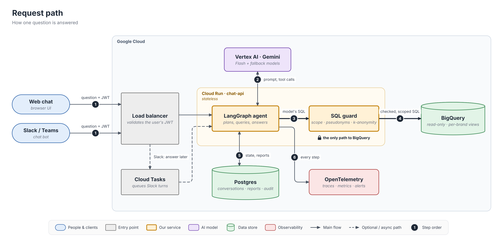
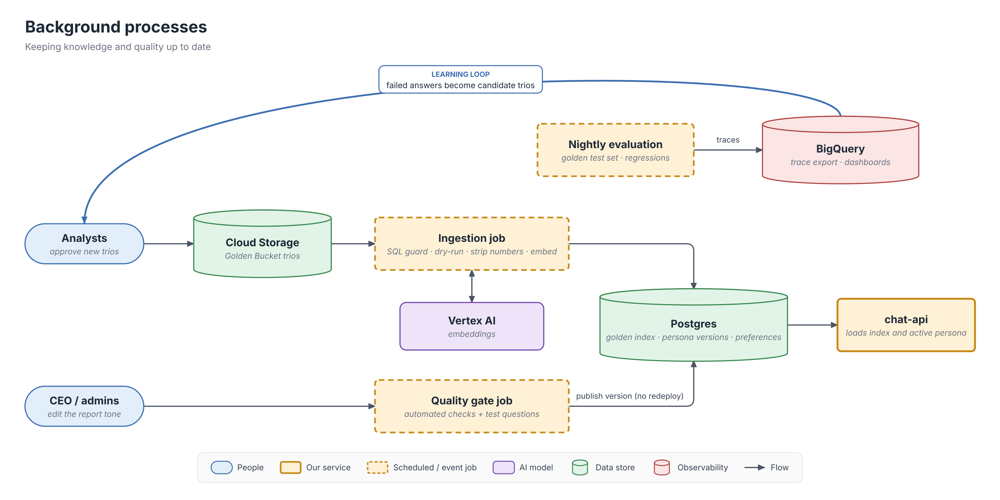
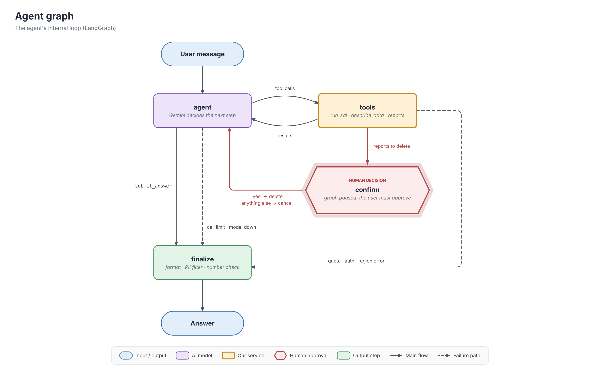

# Retail Analyst Agent — High-Level Design

A chat agent that lets non-technical retail executives analyse sales, customers and products in
BigQuery (`thelook_ecommerce`), discuss the results and get reports with action items.
This document is the production design; the [prototype](../README.md) implements a subset of it
(safety and PII, confirmed deletions, resilience, observability) with the same architecture.

**Contents**

1. [Summary](#1-summary)
2. [Architecture](#2-architecture)
3. [Technology choices](#3-technology-choices)

---

## 1. Summary

**One analyst agent, every guarantee in code.** A single Gemini model plans the analysis, writes
SQL, reads the results and writes the answer, in a loop of tool calls (ReAct) inside a small
LangGraph graph. It is never trusted with anything that must not go wrong. The principle used
throughout is **"the model proposes, the code guarantees"**:

| Must never happen                   | Enforced by code, not by the prompt                                                                                                                      |
| ----------------------------------- | -------------------------------------------------------------------------------------------------------------------------------------------------------- |
| A user sees another brand's data    | Every query is parsed and rewritten so each table contains only the user's brands                                                                        |
| PII appears in an answer            | Scoped tables have no PII columns; customer ids are salted pseudonyms; demographic groups below 5 customers are suppressed; output regex as a safety net |
| The database is changed             | Read-only credentials; only a single `SELECT` over four allowed tables passes the SQL guard                                                            |
| Reports are deleted without consent | Deletion pauses the graph; only the user's exact confirmation of the previewed list deletes                                                              |
| Costs explode                       | Dry-run cost check, a hard byte cap per query, a per-question limit of model calls, retries only for transient errors                                    |
| A failure is invisible              | Every step of every answer is traced with a trace id                                                                                                     |

The model is free where freedom helps: choosing what to query, exploring hypotheses for "why"
questions, and writing the narrative. It answers through a structured `submit_answer` tool that
separates **facts** (each citing the query that produced it) from **hypotheses**,
**recommendations** and **assumptions**, so the reader can always tell what the data shows from
what the model thinks.

**Prototype vs production.** It is one design. The prototype is a CLI over the same graph, tools
and guards; production adds the interface adapters, managed services and the quality layers that
need data or budget the prototype does not have (section 2.3).

---

## 2. Architecture

### 2.1 Production architecture

The system has two parts: the **request path** that answers a question in seconds, and
**background processes** that keep the knowledge, the persona and the quality checks up to date.

**How a question flows** (numbers match the diagram).

1. The client sends the message with the user's JWT (the client's frontend issues it; its
   claims carry the user's brands). The load balancer validates the token; `chat-api` takes the
   user's identity and scope from the claims, never from the conversation. Web clients get
   progress over Server-Sent Events. Slack must be acknowledged within ~3 seconds, so the Slack
   adapter acknowledges at once, queues the turn in Cloud Tasks and edits its message as progress
   arrives (a Cloud Tasks delivery is an HTTP request, so Cloud Run keeps CPU allocated for the
   whole turn).
2. The agent calls Gemini on Vertex AI with the prompt and the tools; Gemini answers with tool
   calls.
3. Every SQL statement the model writes goes to the SQL guard.
4. Only the checked and rewritten statement reaches BigQuery, under a read-only service account.
5. Conversation state, saved reports, the deletion audit, preferences and persona versions are in
   Postgres, so any Cloud Run instance can continue any conversation, including one paused for a
   deletion confirmation.
6. Every step is traced.

**Background processes.** Analysts approve new Question → SQL → Report trios into Cloud Storage;
an ingestion job validates each one with the same SQL guard the agent uses, dry-runs it, strips
numbers and conclusions from the report, embeds it and writes the index to Postgres, where
`chat-api` loads it. The CEO's tone edits go through an automated quality gate and are published
as a new persona version without a redeploy. A nightly evaluation runs the golden test set.
Traces are exported to BigQuery; failed or corrected answers become candidate trios for the
analysts, which closes the learning loop (requirements 1 and 4).

**Where data lives.**

| Data                                                | Store                                   | Notes                                                                                         |
| --------------------------------------------------- | --------------------------------------- | --------------------------------------------------------------------------------------------- |
| Transactions                                        | BigQuery (`thelook_ecommerce`)        | read-only; per-brand authorized views; aggregation threshold rules on demographics            |
| Conversations, checkpoints                          | Cloud SQL Postgres                      | LangGraph Postgres checkpointer; retention N days                                             |
| Saved reports, audit log                            | Cloud SQL Postgres                      | reports private to the author; hard delete; audit keeps who / when / which ids, never content |
| User preferences                                    | Cloud SQL Postgres                      | fixed fields + free-text notes (requirement 4)                                                |
| Persona / tone versions                             | Cloud SQL Postgres                      | versioned; the active version is a pointer (requirement 8)                                    |
| Golden Bucket trios                                 | Cloud Storage                           | source of truth; the ingestion job writes the index to Postgres (pgvector + BM25), chat-api keeps it in memory      |
| Metric glossary, schema descriptions, dialect rules | Git (config files)                      | reviewed changes, regression-tested                                                           |
| Traces, metrics                                     | OpenTelemetry backend + BigQuery export | PII-redacted, access-restricted, retention-limited                                            |
| Secrets                                             | Secret Manager                          | API keys, pseudonym salt                                                                      |

### 2.2 The agent graph

- **agent** calls the model with the system prompt (role, rules, schema of the user's scoped
  tables, metric glossary, SQL dialect rules, today's date and data range, the user's scope,
  and up to two Golden Bucket examples) plus a trimmed history. Function calling runs in mode
  `ANY`: the model cannot reply in free text, it must call a tool, and the final answer is the
  `submit_answer` tool. A hard limit (6 model calls per question) ends the turn honestly instead
  of looping.
- **tools** executes the model's tool calls through a registry. Each tool has a risk class
  (section 7): read-only tools run at once; `delete_reports` only finds the reports and records
  them as pending, it has no side effects.
- **confirm** pauses the graph with LangGraph's `interrupt`. The next user input resumes it; code,
  not the model, compares the answer with the required confirmation. Because the node re-runs
  from the top on resume, nothing before the `interrupt` has side effects.
- **finalize** turns the structured answer into text, applies the PII regex, and checks that the
  numbers in the facts appear in the cited query results (non-blocking: mismatches go to the
  trace as a quality metric).

### 2.3 Production and prototype

| Component                             | Production                                                          | Prototype                                                |
| ------------------------------------- | ------------------------------------------------------------------- | -------------------------------------------------------- |
| Interface                             | Web chat, Slack/Teams adapters over one `chat-api`                | CLI (`analyst --user …`)                              |
| Identity                              | JWT from the client's frontend, brands from claims                  | `--user` + `config/users.yaml`                       |
| Agent graph, tools, `submit_answer` | same                                                                | same                                                     |
| Data access                           | SQL guard **and** BigQuery authorized views per brand         | SQL guard (the public dataset cannot carry our policies) |
| k-anonymity                           | BigQuery aggregation threshold rules + guard                        | guard + result suppression (min group 5)                 |
| Deletion confirmation                 | same                                                                | same                                                     |
| Numbers in answers                    | placeholders bound to query columns, rendered by code               | model writes numbers; non-blocking number check          |
| Critic (quality review of reports)    | one extra model call for reports                                    | —                                                       |
| Golden Bucket                         | hybrid retrieval (BM25 + embeddings), ingestion pipeline            | 10 trios, BM25, same safety validation                   |
| State                                 | Postgres (checkpoints, reports, preferences, persona)               | in-memory checkpointer, SQLite reports                   |
| Models                                | Gemini Flash on Vertex AI, fallback chain                           | Gemini 3.5 Flash-Lite on AI Studio, 2 fallbacks          |
| Tracing                               | OpenTelemetry → backend by data-residency rule; dashboards, alerts | JSONL per session + `/trace`                           |
| Persona / tone                        | admin page, versions, automated quality gate                        | — (design only)                                         |

**What is simplified and what is not.** Safety is complete in the prototype: it cannot show PII,
another brand's data or delete without confirmation. Quality controls are reduced (no critic, no
number placeholders), because they need a paid model budget and an evaluation set; the free tier
allows ~15 requests per minute.

---

## 3. Technology choices

Each choice lists the alternatives and **when we would choose differently**.

### 3.1 Cloud: Google Cloud

The client prefers AWS and accepts GCP or a cloud-agnostic design with a justification. We chose
**GCP**, because the two systems the agent talks to on every question already live there: the
data is in **BigQuery** and the model is **Gemini**. On GCP:

- **No cross-cloud traffic on the hot path.** A question makes 2–5 model calls and several
  queries; from AWS each would cross clouds, adding latency and egress cost.
- **One identity system.** The agent's service account reads BigQuery and calls Vertex AI with
  IAM, no exported keys. From AWS it needs Workload Identity Federation for both.
- **Data stays where it is.** Query results and prompts never leave the provider that already
  holds the data, which simplifies the data-protection story.
- **The engine enforces privacy.** BigQuery authorized views and aggregation threshold rules
  give a second, database-level layer for brand scoping and k-anonymity.

**The design is portable.** Every component is a container, Postgres, a queue or OpenTelemetry.
If the platform must be AWS, the same architecture maps as follows:

| Role                       | GCP (chosen)                                     | AWS equivalent                                |
| -------------------------- | ------------------------------------------------ | --------------------------------------------- |
| Stateless agent service    | Cloud Run                                        | App Runner or ECS Fargate                     |
| Async turns (Slack)        | Cloud Tasks                                      | SQS                                           |
| State database             | Cloud SQL for PostgreSQL                         | RDS / Aurora PostgreSQL                       |
| Golden Bucket storage      | Cloud Storage                                    | S3                                            |
| Scheduled jobs             | Cloud Scheduler + Cloud Run jobs                 | EventBridge Scheduler + ECS tasks / Lambda    |
| Secrets                    | Secret Manager                                   | Secrets Manager                               |
| Tracing and alerts         | Cloud Trace / Logging / Monitoring (or Langfuse) | X-Ray / CloudWatch (or Langfuse)              |
| BigQuery and Gemini access | service account (IAM)                            | Workload Identity Federation from an IAM role |

We would choose AWS if the client's platform team runs everything there and the data or the
model moves too (for example the warehouse to Redshift and the model to Bedrock).

### 3.2 Compute: Cloud Run

| Option                       | Better when                                            | Why not here                                                                                                                       |
| ---------------------------- | ------------------------------------------------------ | ---------------------------------------------------------------------------------------------------------------------------------- |
| **Cloud Run** (chosen) | one service, uneven load, no ops team                  | —                                                                                                                                 |
| Vertex AI Agent Engine       | minimal operations, built-in sessions and memory       | less control over our flow: the confirmation pause, Slack async turns, progress streaming; stronger lock-in. The main alternative. |
| GKE                          | the company already runs Kubernetes with many services | cluster operations for a single service                                                                                            |
| Compute Engine VM            | special runtime needs                                  | we would patch, scale and restart it ourselves                                                                                     |
| Cloud Functions              | short event handlers                                   | 30–60 s streamed turns                                                                                                            |

The service is **stateless**: instances come and go, so all state is in Postgres.

### 3.3 Models: Gemini

| Use                        | Production                                       | Prototype                                            |
| -------------------------- | ------------------------------------------------ | ---------------------------------------------------- |
| Analyst (every question)   | Gemini Flash (`gemini-3.8-flash`) on Vertex AI | `gemini-3.5-flash-lite` on AI Studio               |
| Fallbacks                  | another Flash version, then Flash-Lite           | `gemini-3.1-flash-lite`, then `gemini-3.6-flash` |
| Critic (reports only)      | Flash or Pro, chosen by evaluation               | —                                                   |
| Embeddings (Golden Bucket) | Gemini embeddings                                | — (BM25 only)                                       |

- **Why Gemini:** the client's preference, and the same cloud as the data (section 3.1). The
  framework is model-agnostic, so a provider change is configuration.
- **Why not Pro for the analyst:** latency (answers already take 10–30 s), cost on every
  question, and no free tier; the hard guarantees are in code, not in model strength. We would
  route complex questions to Pro if evaluation shows Flash failing on them.
- **Why Flash-Lite in the prototype:** measured free-tier limits are 15 requests/min and
  **500/day** for each Flash-Lite model against **20/day** for Flash; a question takes 2–5 calls.
  Each fallback model has its **own quota**, so the chain adds capacity, not only availability.
  This mattered in practice: during testing both Flash-Lite models returned
  `503 high demand` at the same time and the third model answered.
- **AI Studio vs Vertex AI:** AI Studio's free tier may use requests to improve Google's products
  (stated on the official pricing page); client data in production goes through Vertex AI (IAM,
  regional endpoints, no training on customer data, SLA).

### 3.4 Agent framework: LangGraph

| Option                       | Better when                                 | Why not here                                                                                                                                                                                                                                               |
| ---------------------------- | ------------------------------------------- | ---------------------------------------------------------------------------------------------------------------------------------------------------------------------------------------------------------------------------------------------------------- |
| **LangGraph** (chosen) | explicit control of steps, pauses and state | —                                                                                                                                                                                                                                                         |
| Google ADK                   | GCP-native agents deployed to Agent Engine  | community reports (March 2026) showed tool confirmation not working with persistent sessions ([issue](https://github.com/google/adk-python-community/issues/111)), and deletion confirmation with stored state is a hard requirement. The main alternative. |
| Plain Gemini SDK + own loop  | a very small agent                          | pause/resume, state persistence and retries would be ours to write and test                                                                                                                                                                                |
| CrewAI / AutoGen             | several cooperating agents                  | we use one agent (section 1)                                                                                                                                                                                                                               |

Why LangGraph: the confirmation is a **graph node** with `interrupt`, so it cannot be skipped;
pause and state persistence come with a Postgres checkpointer, which fits the stateless Cloud Run
service; it is model-agnostic (fallbacks across models); and it integrates with OpenTelemetry,
Langfuse and LangSmith. Trade-offs we accept: more abstraction than a hand-written loop, and
frequent version changes in the LangChain ecosystem (versions are pinned in `uv.lock`).

**My experience with it:** I built a production text-to-SQL agent on LangGraph for a marketplace
(about 230 data marts, questions in three languages): a planner → retrieval → SQL generator →
validator → read-only execution → critic graph on a self-hosted 72B model, with a 400-question
golden set, regression tests in CI, shadow mode and canary releases (Success@1 of 76%). Lessons
from it shaped this design: value lookup for filters (`describe_data`), per-step tool scoping,
a cost guard in the SQL validator, and a checklist-style critic.

### 3.5 Other choices

| Area             | Choice                                                                   | Alternatives and when                                                                                                                                                                                                                                       |
| ---------------- | ------------------------------------------------------------------------ | ----------------------------------------------------------------------------------------------------------------------------------------------------------------------------------------------------------------------------------------------------------- |
| SQL safety       | **sqlglot AST**: parse, check, rewrite, regenerate                 | regex on SQL (bypassed by comments, aliases, case); only a read-only role (blocks writes, not other brands or PII)                                                                                                                                          |
| State database   | **Postgres**                                                       | Firestore (no maintained LangGraph checkpointer; reports, audit and preferences are relational); BigQuery (analytical, slow single-row writes); Redis (not durable enough for an audit log)                                                                 |
| Golden retrieval | **in-memory index** (BM25 now, + embeddings in production)         | Postgres pgvector + BM25 at tens of thousands of trios; BigQuery `VECTOR_SEARCH` adds seconds per question; Vertex AI Vector Search is for millions                                                                                                       |
| Tracing          | **OpenTelemetry**, backend by rule                                 | data must stay in the client's cloud and nobody operates extra services → Cloud Trace/Logging; data must stay and a team can operate it → self-hosted Langfuse (Postgres, ClickHouse, Redis, object storage); SaaS allowed → Langfuse Cloud or LangSmith |
| Python tooling   | **uv** + `pyproject.toml`, `requirements.txt` exported for pip | —                                                                                                                                                                                                                                                          |
